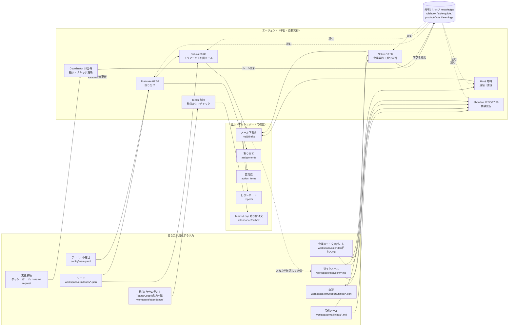

# Nakama — 自分の PC で毎日動く Claude エージェント・フリート

Anthropic の記事「[日本の Anthropic BDR が Claude Managed Agents を活用して日々の業務をどのように運営しているか](https://claude.com/ja/resources/articles/how-an-anthropic-japan-business-development-representative-runs-his-day)」のワークフローを、**セルフホスト（自分の PC / コンテナ）で再現する** ためのテンプレートです。

> 📘 **使い方・データの保存先と送り先・コネクタの追加方法は [docs/GUIDE.md](docs/GUIDE.md)** にまとめています（ダッシュボードの「使い方」タブでも読めます）。

1 つの役割だけを持つエージェント 6 体（＋記事にない追加の Kintai / Kihyo）が、共有ナレッジベースを読み書きしながらスケジュール実行されます。成果物はすべて「下書き」で、送信・確定は人間が行います。

| エージェント | 役割 | モデル | 既定スケジュール（平日） |
|---|---|---|---|
| **Furiwake**（振り分け） | 受信リードをチームに割り当て | Sonnet | 07:30 |
| **Sabaki**（捌き） | 自分のリードをトリアージし初回メール下書き | Opus | 08:00 |
| **Henji**（返事） | 受信メールへの返信下書き（JA/EN）。難所だけ Opus アドバイザーに相談 | Sonnet + Opus advisor | 毎時 09:05–18:05（新着がなければ起動しない） |
| **Shoudan**（商談） | やり取りから商談レコードを更新 | Sonnet | 12:30 / 17:30 |
| **Nokori**（残り） | 会議要約＋フォローアップ下書き、下書き→送信版の差分学習 | Opus | 18:30 |
| **Kintai**（勤怠・追加） | Teams / Loop の勤怠連絡のかぶり・穴チェック、自分の勤怠の貼り付け文作成 | Sonnet | 08:45 / 毎時（入力が変わったときだけ） |
| **Kihyo**（起票・追加・任意） | 同期フォルダの議事メモから Planner 起票 JSON を作り、Power Automate を起動（手順は自分の SKILL.md を読み込む） | Opus | 12:00 / 19:00（毎日） |
| **Coordinator** | 平易な言葉の変更依頼で各エージェントの指示とナレッジを更新 | Opus | 15 分ごと（依頼がなければ起動しない） |

## 全体フロー



### 入力はどこに置くか

既定の `local` モードでは、エージェントは **`workspace/` 配下のファイルだけ** を読みます（実メールや CRM には自動では繋がりません）。`init --demo` で入るのは架空のサンプルです。

| 入力 | 置き場所 | 使うエージェント | 実サービスにつなぐなら |
|---|---|---|---|
| リード | `workspace/crm/leads/*.json`（`status: "new"`） | Furiwake → Sabaki | `connectors.crm: mcp:salesforce` 等 |
| 受信メール | `workspace/mail/inbox/*.md`（`status: new`） | Henji, Shoudan | `connectors.mail: mcp:gmail` 等 |
| 送ったメール | `workspace/mail/sent/*.md` | Shoudan, Nokori（学習） | 同上 |
| 会議メモ・文字起こし | `workspace/calendar/YYYY-MM-DD/*.md` | Nokori, Shoudan | `connectors.calendar: mcp:gcal` 等 |
| 商談 | `workspace/crm/opportunities/*.json` | Shoudan | `connectors.crm` |
| チーム・不在日 | `config/team.yaml` | Furiwake | — |
| ルール・文体・製品情報 | `knowledge/*.md` | 全員 | — |
| 勤怠 | 自分の予定: `workspace/attendance/mine.md`（ダッシュボード「勤怠」から追加）／チームの連絡: 同タブで Teams・Loop を貼り付け → `workspace/attendance/sources/` | Kintai | 下記「勤怠の自動取得」 |
| 変更依頼 | ダッシュボードの「変更依頼」/ `python -m nakama request "..."` | Coordinator | `connectors.chat: mcp:slack` |

> **勤怠の自動取得**: Teams は Power Automate で「チャネルのメッセージ → OneDrive のファイル」に書き出し、OneDrive 同期フォルダを `workspace/attendance/sources/` に向けるのが一番手軽（管理者同意が不要なことが多い）。返信まで取れるかはテナント・トリガー次第なので要検証。Loop は公開された書き込み API が見当たらないため、Kintai が作る貼り付け文を手で貼る運用。

ファイル形式は [workspace/README.md](workspace/README.md)、MCP での接続手順は [docs/GUIDE.md](docs/GUIDE.md) の 6〜7 章を参照。

## 記事の構成とこのリポジトリの対応

| 記事（Claude Managed Agents） | このリポジトリ（セルフホスト） |
|---|---|
| エージェントのシステムプロンプト | `agents/<name>/AGENT.md`（共有・git 管理）＋ `LOCAL.md`（個人チューニング・git 管理外） |
| 指示のバージョン履歴 | `agents/<name>/versions/v001.md…`（LOCAL.md の変更を自動保存）。`pin_version` で固定可 |
| デプロイ時のスケジュール | `config/fleet.yaml` の cron → 常駐スケジューラ（APScheduler） |
| 共有メモリストア | `knowledge/` |
| 認証情報ボールト | `.env` ＋ エージェントごとに必要な MCP サーバーだけを渡す ＋ ファイルアクセスをフックで制限 |
| アドバイザー戦略 | Henji（Sonnet）に Opus のサブエージェント `advisor` を付与 |
| 実行トレース（Console） | `logs/runs/<日付>/<agent>-<時刻>.jsonl` |
| Slack チャンネル / Claude Tag | `workspace/requests/`・`workspace/action_items/`・`workspace/reports/` ＋ 任意で Slack Webhook / MCP |

## フォルダ構成

```
.
├── agents/                 エージェント定義
│   ├── _shared/COMMON.md   全員共通のルール（送信禁止、ナレッジの書き方、エスカレーション）
│   ├── furiwake/ sabaki/ henji/ shoudan/ nokori/ coordinator/
│   │   ├── AGENT.md        役割の基本指示（共有）
│   │   ├── LOCAL.md        個人チューニング（git管理外・Coordinatorが編集）
│   │   └── versions/       LOCAL.md の版管理（git管理外）
├── config/                 *.example.* だけコミット。実体は git 管理外
│   ├── fleet.example.yaml  エージェント・モデル・スケジュール・権限・予算
│   ├── team.example.yaml   チームメンバーと不在日（Furiwake 用）
│   └── mcp.example.json    外部連携（Gmail / Slack / CRM 等の MCP サーバー）
├── knowledge/              共有ナレッジベース（git管理外）
├── templates/knowledge/    ナレッジの雛形
├── workspace/              エージェントが扱う業務データ（git管理外）。形式は workspace/README.md
├── samples/                デモ用の架空データ
├── logs/                   実行トレース・コスト・状態（git管理外）
├── nakama/                 ランナー本体（Python / Claude Agent SDK）
├── scripts/                Windows タスクスケジューラ登録など
├── Dockerfile, compose.yaml
└── tests/
```

## クイックスタート

### 0. 必要なもの
- 次のどちらか 1 つ（下の「認証方式」を参照）
  - Claude API キー（[Claude Console](https://console.anthropic.com/) で発行。使った分だけ課金）
  - Claude のサブスクリプション（個人の Pro / Max、会社の Team / Enterprise）から `claude setup-token` で発行したトークン（手順は [docs/GUIDE.md](docs/GUIDE.md) の 4 章）
- Python 3.10+ **または** Docker（Docker Engine / Docker Desktop / Podman）

### 1. ネイティブで試す（まずはこれ）
```bash
python -m venv .venv
# Windows: .\.venv\Scripts\activate   /  macOS・Linux: source .venv/bin/activate
pip install -e ".[dev]"

python -m nakama init --demo        # config/・knowledge/・.env を雛形から作成 + 架空データを投入
# .env に ANTHROPIC_API_KEY か CLAUDE_CODE_OAUTH_TOKEN のどちらかを設定

python -m nakama list               # エージェント一覧とスケジュール
python -m nakama run furiwake --dry-run   # API を呼ばずにプロンプトと権限を確認
python -m nakama run furiwake       # 1 回だけ実行 → workspace/assignments/ を確認
python -m nakama run sabaki         # → workspace/mail/drafts/ に下書き
python -m nakama costs              # 本日のコスト
```

### 2. 毎日自動で動かす（実行モードを選ぶ）

中身（`python -m nakama serve`）はどのモードでも同じで、変わるのは「誰が常駐させるか」だけです。設定・ナレッジ・データの形式も共通なので、あとからモードを乗り換えられます。

| 環境 | おすすめ | コマンド |
|---|---|---|
| Docker 禁止の会社 PC（Windows） | ネイティブ + タスクスケジューラ | `.\scripts\install-windows-task.ps1` |
| Mac / Linux / WSL | ネイティブ + launchd / systemd | `bash scripts/install-service.sh` |
| 家の NAS・ミニ PC・VPS（24 時間稼働） | Docker | `docker compose up -d --build` |

**A. ネイティブ（Docker 不要）**
```bash
python -m venv .venv && pip install -e .     # クイックスタート 1 と同じ
# Windows (PowerShell)
.\scripts\install-windows-task.ps1           # ログオン時に起動。削除: Unregister-ScheduledTask -TaskName Nakama
# macOS / Linux / WSL
bash scripts/install-service.sh                # 削除: bash scripts/install-service.sh --uninstall
```
- WSL は `/etc/wsl.conf` で `systemd=true` が必要です。WSL は端末を閉じると VM ごと止まることがあるので、Windows 機なら Windows ネイティブ版の方が確実です。

**B. Docker（NAS 等の常時稼働機向け）**
```bash
docker compose up -d --build        # restart: unless-stopped で常駐
docker compose logs -f
docker compose run --rm nakama run henji --force   # 手動実行
```
- NAS では `.env` の `UID` / `GID` を NAS のユーザーに合わせます（SSH で `id` を実行して確認。Synology は多くの場合 `1026` / `100`）。
- Synology は Container Manager の「プロジェクト」でこのフォルダを指定すれば、`compose.yaml` がそのまま使えます。
- 初回は NAS 上で次の順に実行します（PC で作った `config/`・`knowledge/`・`.env` をコピーしても OK）:
  ```bash
  cp .env.example .env                         # compose が起動時に読むので先に作る → API キーと UID/GID を記入
  docker compose run --rm nakama init --demo   # config/・knowledge/ を雛形から作成
  docker compose up -d --build
  ```

> ネイティブ版は **PC が起動している間だけ** 動きます。スリープ中に過ぎた実行は、復帰後 `misfire_grace_seconds`（既定 1 時間）以内なら 1 回だけ追いかけて実行されます。
>
> **同じメールボックスや CRM につないだまま、会社 PC と NAS で同時に動かさないでください。** 下書きが二重にできます。モードを乗り換えるときは、古い方を止めてから新しい方を起動します。

## 日々の使い方

### ダッシュボード（ブラウザ）
```bash
python -m nakama ui              # 画面だけ起動 → http://localhost:8765
python -m nakama serve --ui      # スケジューラと一緒に起動（常駐スクリプトと Docker はこちらが既定）
# --open を付けるとブラウザも自動で開く（Windows / macOS の常駐スクリプトは付けて登録済み）
```
画面は 7 つのグループに分かれています（上の段でグループ、下の段でタブを選ぶ）。

| グループ | 主な機能 |
|---|---|
| ダッシュボード | エージェントの関係図（待ち件数・エラー・実行中を色で表示、▶ で実行、▶ 全部 で一括）、自分のタスク、エスカレ欄（通知を 1 行ずつ、OK で既読、🤖 で相談）、メモ欄、不在カレンダー、今日のスケジュール |
| タスク | 統合タスク一覧（Planner 起票履歴・ルーティン・手書き ToDo ノートを出典つきで。月の切り替え、✓ で完了、📅 で期日変更、🤖 で相談）、ノートのエディタ、ルーティン（営業日ベースの月表・状態・作業メモ・祝日一覧）、起票（任意の Kihyo の状態・手動起票の検証と承認） |
| 対応 | 要対応・下書き・受信・メモ（Kikitori の振り分け提案をボタンで実行、メモの変遷）・変更依頼。完了したものは既定で非表示 |
| 勤怠 | チームの不在のかぶりチェックと貼り付け文（Kintai）、残業の記録と申請文・18:00 リマインド |
| 営業 | 記事のデモ用（リード・商談・割り当て） |
| 記録 | レポート・ナレッジ・コスト（API 換算の実利用とライセンス月額の比較）・ログ |
| 設定 | 設定ファイルの編集（保存前に検証・旧版を保存）、プロフィール、通知テスト、cron の読み方、要望とリリースノート、使い方 |

- 右上の 💬 で、リポジトリを読んで答えるチャット（読み取り専用・チャットごとに履歴）を開けます。
- すべての表で、見出しを押すと並び替え、上の 🔍 で絞り込み、セルを押すと行と列をハイライトします。
- ヘッダーの「サンプルを表示」で、デモ用の架空データ（とそこから作られたもの）を隠せます。
- 下書きは「本文をコピー（要約を除く）」でメーラーに貼れます。変更依頼は画面から送れ、Coordinator が次の実行で反映します。
- 祝日（`config/holidays.json`、内閣府の CSV から取り込み可）は営業日の計算・ルーティン・エージェントへの「今日は何営業日目」に使われ、`skip_holidays: true` のエージェントは祝日に動きません。
- セキュリティ:
  - 既定では `127.0.0.1` だけで待ち受けます。
  - API 呼び出しには起動ごとに発行するトークンが必要です。
  - 読めるのは `workspace/` と `knowledge/` だけで、`.env` や `config/` は表示できません。
- NAS などで LAN から開く場合は、`.env` に `NAKAMA_UI_PASSWORD`（Basic 認証）と `NAKAMA_UI_ALLOW_HOSTS`（例: `nas.local,192.168.1.20`）を設定し、`compose.yaml` のポートを `"8765:8765"` にします。

### 運用の流れ
1. 朝、`workspace/mail/drafts/` の下書きを読む。冒頭の「要約（送信しない）」だけ読めば状況が分かる。
2. 直して送る。送ったメールを `workspace/mail/sent/` に置く（`draft_id` を付ける）と、Nokori が差分を学習して `knowledge/` を更新する。
3. `workspace/action_items/` は人間の判断待ち。
4. 振る舞いを変えたいときは平易な言葉で依頼する:
   ```bash
   python -m nakama request "Henji: 英語メールの結びは Thanks, にして"
   ```
   15 分以内に Coordinator が該当エージェントの `LOCAL.md` を更新し、`versions/` に新しい版が残る。

## 外部サービスとつなぐ

既定は全部ローカルファイル（`connectors: local`）なので、連携なしでも動きます。実運用では `config/mcp.json` に MCP サーバーを定義し、`config/fleet.yaml` を切り替えます。

```yaml
connectors:
  mail: mcp:gmail
  crm: mcp:salesforce
```

- 各エージェントには `connectors` に書いたサーバーだけが渡されます（最小権限）。
- 送信系のツールは `disallowed_tools: ["mcp__gmail__send_email"]` のように明示的に塞いでください（ツール名は使う MCP サーバー次第）。
- Slack にレポートを流すだけなら MCP 不要。`.env` の `SLACK_WEBHOOK_URL` を設定するだけです。

## 認証方式（API キー / サブスクリプション）

`config/fleet.yaml` の `auth:` で切り替えます。既定の `auto` は、`CLAUDE_CODE_OAUTH_TOKEN` があればサブスクリプション、なければ API キーを使います。

| | `api_key` | `subscription` |
|---|---|---|
| `.env` | `ANTHROPIC_API_KEY` | `CLAUDE_CODE_OAUTH_TOKEN` |
| 料金 | 使った分だけ API 課金 | サブスクリプションの利用枠内（実行ごとの課金なし） |
| 上限 | `max_budget_usd` / `daily_budget_usd` | 同じ設定が「推定コスト」に対する使い過ぎ防止として効く。加えてプランの利用制限（5 時間枠など）に当たると、その回は失敗する |
| 向いている使い方 | 配布先・チーム運用・業務利用 | 自分 1 人の PC で回す |

サブスクリプションで使う手順:
```bash
claude setup-token      # Claude Code CLI が必要。ブラウザでログイン → 有効期間 1 年のトークンが表示される
# 表示されたトークンを .env の CLAUDE_CODE_OAUTH_TOKEN= に貼る
python -m nakama run furiwake --dry-run   # 最後の行が auth=subscription になっていれば OK
```

- CLI は両方の認証情報があると API キーを優先します。そのため、サブスクリプションモードでは Nakama が `ANTHROPIC_API_KEY` を環境から外して起動します。うっかり API に課金されることはありません。
- レポートのコスト表示には `est.` が付きます。これは CLI の推定値で、実際に請求される額ではありません。
- **配布について:** Anthropic は「第三者の開発者が自分のプロダクトで claude.ai ログインを提供すること」を、事前承認なしには認めていません（[Agent SDK overview](https://code.claude.com/docs/en/agent-sdk/overview)）。Nakama は「各自が自分のトークンを自分の PC で使う」前提です。他人にトークンを配る、1 つのインスタンスを複数人で共有する、といった使い方はしないでください。

## 安全設計

- エージェントの読み取りは `agents/`・`knowledge/`・`workspace/` のみ。`.env`・`config/` は読めません（`nakama/guard.py`）。
- 書き込みはエージェントごとの `writes` に限定。Coordinator も `AGENT.md`（共有の基本指示）や `fleet.yaml`（権限）は編集できません。
- Bash は与えていません。`permission_mode: dontAsk` で許可リスト外のツールは自動拒否。
- 1 回あたり `max_budget_usd`、1 日あたり `daily_budget_usd` で上限を設定。

## 配布するとき

- `config/*.yaml`・`config/*.json`・`.env`・`knowledge/`・`workspace/`・`logs/`・`agents/*/LOCAL.md`・`agents/*/versions/` は `.gitignore` 済み。**共有されるのは仕組みと雛形だけ** です。
- 受け取った人は `init` → `.env` 設定 → `knowledge/rulebook.md` を自分の業務に書き換え、で始められます。
- `samples/` と `templates/knowledge/` は架空の製品・会社を想定したサンプルです。

## テスト
```bash
pytest          # API を呼ばないオフラインテスト（権限ガード・設定・cron）
```

## ライセンス

[MIT](LICENSE)
